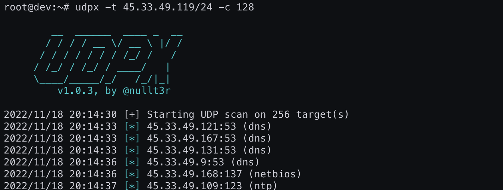

# NOTE: This is an `udpx` fork

[Go to the original `udpx` repository](https://github.com/nullt3r/udpx)

Small enhancements to `udpx`:

--------------------------------------------------------------------------------
**/Enhancements**

- `-v | --version` : Print version and exit.
- `-q` : Quiet option. Suppresses banner and progress.
- `-o -` : Write JSONL format to stdout instead of writing to file.  
   **TIP:** Combining `-q` and `-o -` may be useful for scripting. 
- `-b bufsize` : Response buffer size in bytes (recommended 512 for complete response_data, default 32). Valid range: 32-4096 bytes.
- `-s service1[,service2[,...]]` : Scan for one or more services (comma-separated). Example: `-s "dns,ntp,mdns"`. Default: scans all services.
- `--src-ip` : Source IP address option. Use an explicit IP address as source.
- `--exclude TARGETS`  : List of comma-separated targets to be excluded from the scan, even if they are part of the overall target list.
- `--excludefile FILE` : The same functionality as the `--exclude` option, except that the excluded targets are provided in a `FILE` rather than on the command line.  
  `FILE` format: Targets in the file can be separated by a space, tab, or newline.
  Comments: You can add comments by starting a line with a # symbol. Everything will be ignored after the `#` on that line.
- **Extended Target Syntax**: All target-list options (`-t`, `-tf`, `--exclude`, `--excludefile`) support: IP addresses, CIDR blocks, octet-ranges (e.g. `192.0.2.1-3`), and hostnames. The `-t` option accepts a list of one or more *space*-separated targets or positional arguments. The `--exclude` option accepts a list of one or more *comma*-separated targets.
- **Nmap-style positional arguments**: Targets can be specified as positional arguments (like nmap): `udpx -q -o - 192.168.1.1 192.168.2.0/24`

**/End-Of-Enhancements**

--------------------------------------------------------------------------------


# 
Fast and lightweight, UDPX is a single-packet UDP scanner written in Go that supports the discovery of over 45 services with the ability to add custom ones. It is easy to use and portable, and can be run on Linux, Mac OS, and Windows. Unlike internet-wide scanners like zgrab2 and zmap, UDPX is designed for portability and ease of use.

* It is fast. It can scan whole /16 network in ~20 seconds for a single service.
* You don't need to instal libpcap or any other dependencies.
* Can run on Linux, Mac Os, Windows. Or your Nethunter if you built it for Arm.
* Customizable. You can add your probes and test for even more protocols.
* Stores results in JSONL format.
* Scans also domain names.

## How it works
Scanning UDP ports is very different than scanning TCP - you may, or may not get any result back from probing an UDP port as UDP is a connectionless protocol. UDPX implements a single-packet based approach. A protocol-specific packet is sent to the defined service (port) and waits for a response. The limit is set to 500 ms by default and can be changed by `-w` flag. If the service sends a packet back within this time, it is certain that it is indeed listening on that port and is reported as open.

A typical technique is to send 0 byte UDP packets to each port on the target machine. If we receive an "ICMP Port Unreachable" message, then the port is closed. If an UDP response is received to the probe (unusual), the port is open. If we get no response at all, the state is open or filtered, meaning that the port is either open or packet filters are blocking the communication. This method is not implemented as there is no added value (UDPX tests only for specific protocols).

## Usage




> :warning: **Concurrency:** By default, concurrency is set to 32 connections only (so you don't crash anything). If you have a lot of hosts to scan, you can set it to 128 or 256 connections. Based on your hardware, connection stability, and ulimit (on *nix), you can run 512 or more concurrent connections, but this is not recommended.

To scan a single IP:
```
udpx -t 1.1.1.1
```

To scan a CIDR with maximum of 128 connections and timeout of 1000 ms:
```
udpx -t 1.2.3.4/24 -c 128 -w 1000
```

To scan targets from file with maximum of 128 connections for only specific service:
```
udpx -tf targets.txt -c 128 -s ipmi
```

To scan with multiple services (DNS, NTP, mDNS) and increased buffer size:
```
udpx -t 1.2.3.4/24 -c 128 -s "dns,ntp,mdns" -b 512
```

Target can be:
* IP address
* CIDR
* Domain

IPv6 is supported.

If you want to store the results, use flag `-o [filename]`. Output is in JSONL format, as can be seen bellow:

```jsonl
{"address":"45.33.32.156","hostname":"scanme.nmap.org","port":123,"service":"ntp","response_data":"JAME6QAAAEoAAA56LU9vp+d2ZPwOYIyDxU8jS3GxUvM="}
```

## Options
```

        __  ______  ____ _  __
       / / / / __ \/ __ \ |/ /
      / / / / / / / /_/ /   /
     / /_/ / /_/ / ____/   |
     \____/_____/_/   /_/|_|
         udpx v1.0.8, by @nullt3r

Usage of ./udpx:
  ./udpx [options] [targets...]

Options:
  -c num
    	Maximum number of concurrent connections (default 32)
  -b bufsize
    	Response buffer size in bytes (recommended 512 for complete response_data, default 32, max 4096)
  --exclude host1[,host2[,...]]
    	Comma-separated list of targets to exclude from the scan (IPs/hostnames/CIDRs/octet-ranges)
  --excludefile filename
    	Path to a file with targets to exclude, separated by newlines, spaces, or tabs; '#' starts an end-of-line comment
  -nr
    	Do not randomize addresses
  -o filename
    	Output file to write results
  -q
    	Quiet mode: suppress banner and progress log lines (results still emitted)
  -s service1[,service2[,...]]
    	Comma-separated list of services to scan, e.g. dns,ntp,snmp (available: ard, bacnet, chargen, citrix, coap, db, digi, dns, ipmi, ldap, mdns, memcache, mssql, nat, netbios, netis, ntp, openvpn, pca, portmap, qotd, rdp, ripv, sentinel, sip, snmp, ssdp, tftp, ubiquiti, upnp, valve, wdbrpc, wsd, xdmcp, kerberos, ike, radius, dtls)
  -sp
    	Show received packets (only first 32 bytes)
  --src-ip ip-address
    	Source IP to bind probes to (must be assigned to a local interface; overrides the kernel's default route-table pick)
  -t host1[ host2[ ...]]
    	IPs/hostnames/CIDRs/octet-ranges to scan (nmap target specification syntax)
  -tf filename
    	File containing IPs/hostnames/CIDRs/octet-ranges to scan
  -v | --version
    	Print version and exit
  -w ms
    	Maximum time to wait for a response (socket timeout) in ms (default 500)

Targets:
  Targets can be specified as positional arguments (like nmap) OR via -t/-tf flags.
  Examples:
    ./udpx 192.168.1.1 192.168.2.0/24
    ./udpx -t 192.168.1.1 192.168.2.0/24
    ./udpx -tf targets.txt
```

## Building
You can grab prebuilt binaries in the release section. If you want to build UDPX from source, follow these steps:

From git:
```
git clone https://github.com/nullt3r/udpx
cd udpx
go build ./cmd/udpx
```
You can find the binary in the current directory.

Or via go:
```
go install -v github.com/nullt3r/udpx/cmd/udpx@latest
```

After that, you can find the binary in `$HOME/go/bin/udpx`. If you want, move binary to `/usr/local/bin/` so you can call it directly.

## Supported services
The UDPX supports more then 45 services. The most interesting are:
* ipmi
* snmp
* ike
* tftp
* openvpn
* kerberos
* ldap

The complete list of supported services:
* ard
* bacnet
* bacnet_rpm
* chargen
* citrix
* coap
* db
* db
* digi1
* digi2
* digi3
* dns
* ipmi
* ldap
* mdns
* memcache
* mssql
* nat_port_mapping
* natpmp
* netbios
* netis
* ntp
* ntp_monlist
* openvpn
* pca_nq
* pca_st
* pcanywhere
* portmap
* qotd
* rdp
* ripv
* sentinel
* sip
* snmp1
* snmp2
* snmp3
* ssdp
* tftp
* ubiquiti
* ubiquiti_discovery_v1
* ubiquiti_discovery_v2
* upnp
* valve
* wdbrpc
* wsd
* wsd_malformed
* xdmcp
* kerberos
* ike

## How to add your own probe?
Please send a feature request with protocol name and port and I will make it happen. Or add it on your own, the file `pkg/probes/probes.go` contains all available payloads. Specify the protocol name, port and packet data (hex-encoded).

```go
{
        Name: "ike",
        Payloads: []string{"5b5e64c03e99b51100000000000000000110020000000000000001500000013400000001000000010000012801010008030000240101"},
        Port: []int{500, 4500},
},
```

## Credits
* [Nmap](https://nmap.org/)
* [UDP Hunter](https://github.com/NotSoSecure/udp-hunter)
* [ZGrab2](https://github.com/zmap/zgrab2)
* [ZMap](https://github.com/zmap/zmap)

## Disclaimer
I am not responsible for any damages. You are responsible for your own actions. Scanning or attacking targets without prior mutual consent can be illegal.

## License
UDPX is distributed under [MIT License](https://raw.githubusercontent.com/nullt3r/udpx/main/LICENSE).
